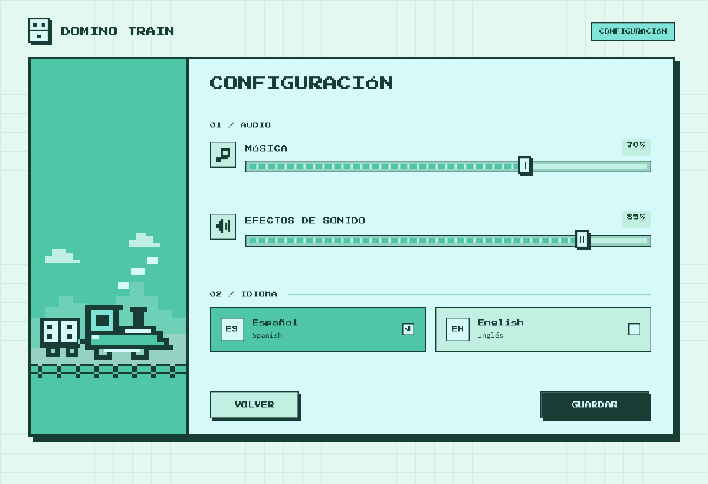

# Domino Train

Interfaz de configuración de un juego de dominó, realizada con **WPF y .NET 10**.



## Abrir y ejecutar

En Windows, con el SDK de .NET 10 y las herramientas de desarrollo de escritorio de .NET:

1. Abre `DominoTrain.slnx` en una versión compatible de Visual Studio.
2. Selecciona `DominoTrain` como proyecto de inicio y ejecuta con **F5**.
3. En `MainWindow`, pulsa **CONFIGURACIÓN** para abrir `SettingsWindow` como ventana independiente.
4. Cierra la configuración con la **X** de la ventana para regresar a la principal.

También puedes ejecutar desde la raíz del repositorio:

```powershell
dotnet run --project src/DominoTrain/DominoTrain.csproj
```

## Alcance

La vista de configuración toma como base el XAML proporcionado por el usuario y conserva sus ajustes visuales:

- Música, inicialmente al 70 %.
- Efectos de sonido, inicialmente al 85 %.
- Cambio inmediato entre **Español** y **English**.
- Botones **Volver** y **Guardar**, sin acciones asociadas.

Los controles permiten mover los indicadores y seleccionar una opción, pero no reproducen audio ni guardan preferencias.
La selección ES/EN traduce al instante las ventanas abiertas y mantiene una única opción marcada.
El idioma se conserva al reabrir la configuración durante la sesión; al reiniciar, vuelve al español.
Cambiar de idioma no modifica los niveles de volumen ni vuelve a crear la ventana.
El idioma se actualiza mediante enlaces de datos; el evento de navegación abre la configuración desde `MainWindow`.
`MainWindow` permanece como ventana de inicio y la configuración se abre con `Owner` y `ShowDialog()`.

## Organización

```text
DominoTrain.slnx
.editorconfig
src/DominoTrain/
├── App.xaml
├── App.xaml.cs
├── DominoTrain.csproj
├── Views/
│   ├── MainWindow.xaml
│   ├── MainWindow.xaml.cs
│   ├── SettingsWindow.xaml
│   └── SettingsWindow.xaml.cs
├── ViewModels/
│   └── LocalizationViewModel.cs
├── Resources/
│   ├── SettingsDefaults.cs
│   ├── Localization/
│   │   ├── UiStrings.resx
│   │   └── UiStrings.en.resx
│   └── Styles/
│       └── PixelTheme.xaml
└── Assets/Fonts/
    ├── PressStart2P-Regular.ttf
    └── OFL.txt
docs/
├── configuracion.png
└── CodingStandard.md
```

## Estándar de codificación

Se aplican las reglas pertinentes de `EstandarTecnologias-Equipo 4.pdf`:

- Identificadores y comentarios en inglés.
- PascalCase para tipos, métodos y constantes; camelCase para parámetros y variables.
- `_camelCase` y acceso privado para los campos generados de los controles de la ventana.
- Cuatro espacios de indentación, llaves Allman y líneas de hasta 120 caracteres.
- Namespaces con ámbito de archivo y directivas `using` explícitas, ordenadas y sin elementos sin utilizar.
- Textos de interfaz en `.resx`, consultados mediante `UiStrings.ResourceManager` y enlaces de datos.
- Valores iniciales y límites de volumen centralizados en constantes con nombres descriptivos.

`.editorconfig` configura las convenciones que reconoce el editor. La comprobación de 120 columnas se realiza aparte.
Consulta [el detalle de aplicación del estándar](docs/CodingStandard.md).

## Recursos de idioma

`UiStrings.resx` contiene el español y actúa como recurso neutral. `UiStrings.en.resx` contiene el inglés.
Los dos archivos tienen las mismas claves, incluidos títulos, botones, accesibilidad y formato del porcentaje.
Edita los `.resx` para modificar los textos; no escribas etiquetas directamente en el XAML.

La compilación genera automáticamente `UiStrings.g.cs` dentro de `obj` antes de compilar el XAML.
El archivo generado no se edita ni se versiona. No se necesita instalar un generador adicional.
La aplicación inicializa los recursos en español mediante `SettingsDefaults.DefaultLanguageCode`.
`LocalizationViewModel` comparte el idioma y notifica a WPF para actualizar textos y opciones de selección.
Las traducciones siguen procediendo de la clase generada `UiStrings`; no se duplican en el código.

## Diseño

La paleta se declara en `Resources/Styles/PixelTheme.xaml`:

| Recurso | Color |
| --- | --- |
| Glacier | `#D5FAF9` |
| Mist | `#C1F0E2` |
| Frost | `#7FE3D7` |
| Mint | `#96D2C2` |
| Seafoam | `#6DD0B7` |
| Aqua | `#4FC7A7` |

El tono oscuro `#173D35` se utiliza para texto y contornos. La ilustración y los iconos están dibujados en WPF.
El diseño de 1200 × 820 se adapta proporcionalmente; el tamaño mínimo de la ventana es 960 × 700.
La tipografía **Press Start 2P** se incluye para funcionar sin conexión; los textos secundarios usan Consolas.

Fuente: [Google Fonts](https://github.com/google/fonts/tree/main/ofl/pressstart2p).
Licencia: [SIL Open Font License](src/DominoTrain/Assets/Fonts/OFL.txt), incluida también al compilar.

## Comprobar la compilación

```powershell
dotnet build DominoTrain.slnx --configuration Release
```
